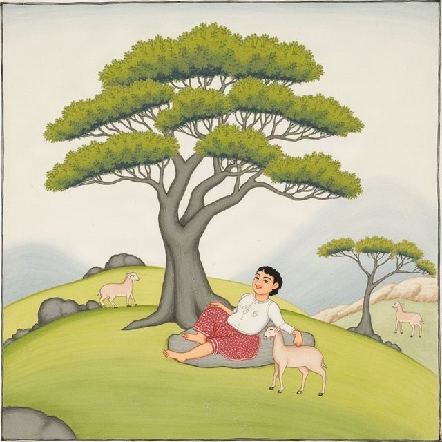
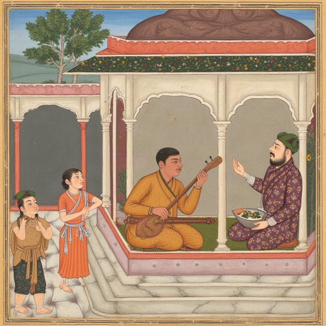
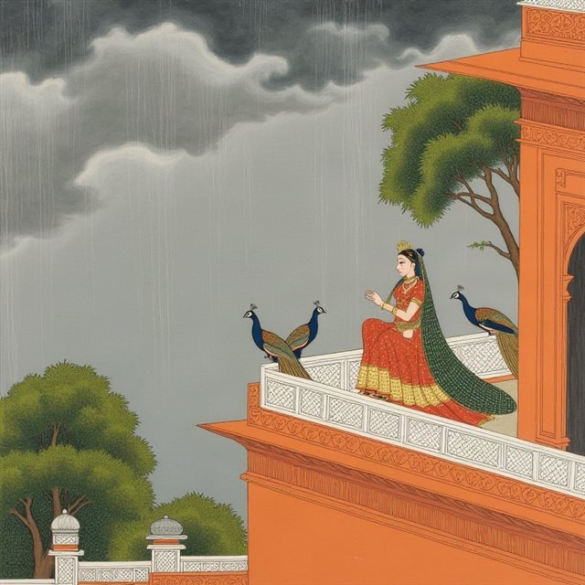
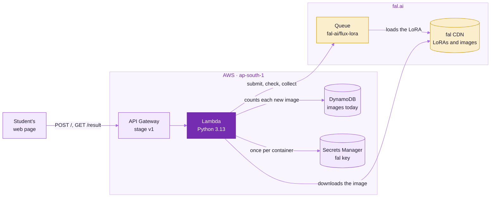

<picture>
  <source media="(prefers-color-scheme: dark)" srcset="docs/readme-kit/assets/hero-dark.svg">
  
</picture>

<p align="center">
  <picture>
    <source media="(prefers-color-scheme: dark)" srcset="https://readme-typing-svg.demolab.com?font=Plus+Jakarta+Sans&weight=600&size=20&duration=2800&pause=900&color=C090F5&center=true&vCenter=true&width=760&lines=Paint+a+prompt+as+a+Kangra+miniature;Or+as+a+Mughal+one%2C+from+the+same+API;Two+calls%3A+start+it%2C+then+collect+it;No+key%2C+any+origin%2C+a+daily+limit">
    
  </picture>
</p>

<p align="center">
  
  
  
  
  
  <a href="https://github.com/cxacraftecosystem-ui/image-generation-gateway/actions/workflows/readme-check.yml"></a>
</p>

**Indian Painting Gateway** is an HTTP API that paints a prompt in the **Kangra** or **Mughal** miniature
style. It runs the two FLUX.1-dev LoRAs from
[Indian-painting-generator](https://github.com/abhilashab4/Indian-painting-generator) on
[fal.ai](https://fal.ai), behind AWS API Gateway and Lambda in ap-south-1 (Mumbai). It answers exactly like
that repository's Modal app and, like it, needs no key, so a page written for the Modal app only changes its
base URL. A daily limit, 1,000 images by default and counted in DynamoDB, caps what it can spend.

<picture>
  <source media="(prefers-color-scheme: dark)" srcset="docs/readme-kit/assets/stats-dark.svg">
  
</picture>

<picture>
  <source media="(prefers-color-scheme: dark)" srcset="docs/readme-kit/assets/divider-dark.svg">
  
</picture>

## &nbsp; What it does

<picture>
  <source media="(prefers-color-scheme: dark)" srcset="docs/readme-kit/assets/cards-dark.svg">
  
</picture>

| Kangra (`"style": "kangra"`) | Mughal (`"style": "mughal"`) |
|---|---|
|  |  |
| *A shepherd boy resting under a tree with his flock on a Himalayan hillside* | *A court musician playing a veena before the emperor in a marble pavilion* |
|  |  |
| *A princess on a palace terrace watching monsoon clouds, peacocks on the parapet* | *A royal hunting party on horseback in a forest with deer* |

All four were made by this API on 20 November 2026 from exactly the prompts shown, at the default settings.
None of the prompts names a style; the API added it
([why](docs/DESIGN.md#why-the-api-adds-the-style-phrase)).

| Feature | Where it lives | Read more |
|---|---|---|
| The two calls, every field, examples and errors | `gateway/handler.py`, `gateway/generation.py` | [API](docs/API.md) |
| The style phrase | `styled_prompt` in `gateway/generation.py` | [Design notes](docs/DESIGN.md#why-the-api-adds-the-style-phrase) |
| The daily image limit | `gateway/daily_limit.py`, `ImagesPerDay` in `template.yaml` | [Operations](docs/OPERATIONS.md#limits) |
| fal's queue | `gateway/fal_queue.py` | [Design notes](docs/DESIGN.md#why-fal-and-not-a-gpu-on-aws) |
| Packaging and deployment | `deploy.ps1`, `stack.ps1`, `template.yaml` | [Operations](docs/OPERATIONS.md#deploying-a-change) |

## &nbsp; How it works

<picture>
  <source media="(prefers-color-scheme: dark)" srcset="docs/readme-kit/assets/pipeline-dark.svg">
  
</picture>

The Lambda does no image work itself. It checks the request, counts it against the daily limit, hands the
job to fal's queue with the right LoRA, and later fetches the finished image and returns it. fal runs
FLUX.1-dev on its own GPUs and bills per image.



## &nbsp; Use the API

The API is open: no key, and calls from any origin are allowed. Its base URL:

```text
https://n5pz0b1to2.execute-api.ap-south-1.amazonaws.com/v1
```

Painting takes longer than one HTTP request should wait, so a page makes two calls: one to start the
painting and one, repeated every few seconds, to collect it.

| Call | Send | Get back |
|---|---|---|
| `POST /` | JSON with `prompt` (required) and `style`, `"kangra"` (the default) or `"mughal"` | `200` with `{"call_id": "…", "status": "queued"}` |
| `GET /result/{call_id}` | nothing | `202` with `{"status": "processing"}` while it paints, then `200` with the image itself: PNG, or JPEG above 1024 × 1024 |

If the prompt doesn't name its style, the API adds `, Kangra miniature painting` or
`, Mughal miniature painting` to the end; without it the LoRAs barely change the image. An image usually
takes 10 to 15 seconds, and about a minute when it is the first after a quiet spell.

```js
const API = "https://n5pz0b1to2.execute-api.ap-south-1.amazonaws.com/v1";

async function paint(prompt, style = "kangra") {
  const start = await fetch(`${API}/`, {
    method: "POST",
    headers: { "Content-Type": "application/json" },
    body: JSON.stringify({ prompt, style }),
  });
  if (!start.ok) throw new Error(await reason(start));
  const { call_id } = await start.json();

  for (;;) {
    await new Promise((resolve) => setTimeout(resolve, 3000));
    const result = await fetch(`${API}/result/${call_id}`);
    if (result.status === 202) continue;
    if (!result.ok) throw new Error(await reason(result));
    return URL.createObjectURL(await result.blob()); // use as an  src
  }
}

async function reason(response) {
  const body = await response.json().catch(() => ({}));
  return body.error || body.message || response.statusText;
}
```

The other fields (`steps`, `guidance`, `width`, `height`, `lora_scale`), Python and curl examples and every
error are in [docs/API.md](docs/API.md).

## &nbsp; Built with

<p align="center">
  <picture>
    <source media="(prefers-color-scheme: dark)" srcset="https://skillicons.dev/icons?i=py,aws,powershell&theme=dark&perline=3">
    
  </picture>
</p>

| Layer | Stack |
|---|---|
| Model | FLUX.1-dev with the Kangra and Mughal LoRAs, run by fal.ai's `fal-ai/flux-lora` through its queue API |
| API | API Gateway REST API, regional, stage `v1`, Lambda proxy integration, CORS preflights answered by mock integrations |
| Code | Python 3.13 on Lambda (arm64, 256 MB, 28 s timeout); the standard library's `urllib` for fal, and `boto3` from the Lambda runtime |
| State | DynamoDB on demand for the daily counter, Secrets Manager for the fal key, CloudWatch logs kept 30 days |
| Deploy | CloudFormation (`template.yaml`), `deploy.ps1` and `stack.ps1` in Windows PowerShell with the AWS CLI v2, packages in S3 |

## &nbsp; Quick start

To deploy it from a fresh clone, in Windows PowerShell with the AWS CLI v2 signed in to the account:

1. Store a fal.ai key that can only call models in Secrets Manager as `indian-painting-gateway/fal-key`
   ([how](docs/SETUP.md#1-the-fal-key)).

2. Copy the styles template and fill in each LoRA's https download address
   ([how, and where to recover them](docs/SETUP.md#2-the-styles)). `gateway/styles.json` stays out of git.

   ```powershell
   Copy-Item styles.example.json gateway\styles.json
   ```

3. Deploy. The first run creates the artifacts bucket; every run prints the API URL.

   ```powershell
   ./deploy.ps1
   ```

Then call it as in [Use the API](#use-the-api) above. Changing the limit, reading the logs, rotating the fal key
and taking it down are in [docs/OPERATIONS.md](docs/OPERATIONS.md).

<picture>
  <source media="(prefers-color-scheme: dark)" srcset="docs/readme-kit/assets/divider-dark.svg">
  
</picture>

## &nbsp; Documentation

| Question | Read |
|---|---|
| How does a page call the API, and what does each field and error mean? | [docs/API.md](docs/API.md) |
| How do I set it up from a fresh clone, and what is in the repository? | [docs/SETUP.md](docs/SETUP.md) |
| How do I deploy a change, change the limit, read the logs, rotate the fal key or take it down? | [docs/OPERATIONS.md](docs/OPERATIONS.md) |
| Where do the stack, the secrets and the logs live, and what does it cost? | [docs/OPERATIONS.md](docs/OPERATIONS.md#where-things-are) |
| Why fal, why the style phrase, why no key, and what is still missing? | [docs/DESIGN.md](docs/DESIGN.md) |
| Where do the LoRAs and the Modal app come from? | [abhilashab4/Indian-painting-generator](https://github.com/abhilashab4/Indian-painting-generator) |
| How is this README built? | [docs/readme-kit/README_STYLE.md](docs/readme-kit/README_STYLE.md) |

## &nbsp; Status

<picture>
  <source media="(prefers-color-scheme: dark)" srcset="docs/readme-kit/assets/timeline-dark.svg">
  
</picture>

The API is live at the base URL above, in the CloudFormation stack `indian-painting-gateway` in ap-south-1,
and serves one trusted student's pages. It allows 1,000 images a day, and since AWS raised the account's quota
on 21 November 2026 the Lambda can run 1,000 calls at once. There are no unit tests; the live API was
checked end to end on 20 November 2026 ([known gaps](docs/DESIGN.md#known-gaps)).

<picture>
  <source media="(prefers-color-scheme: dark)" srcset="docs/readme-kit/assets/footer-dark.svg">
  
</picture>
