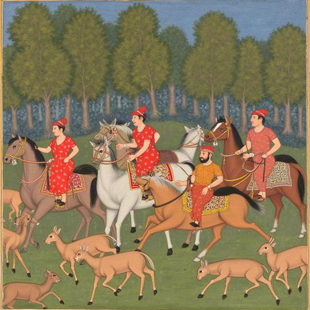
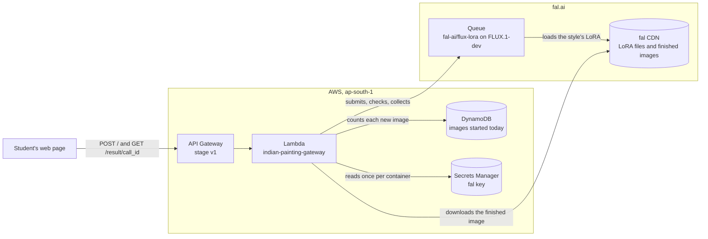
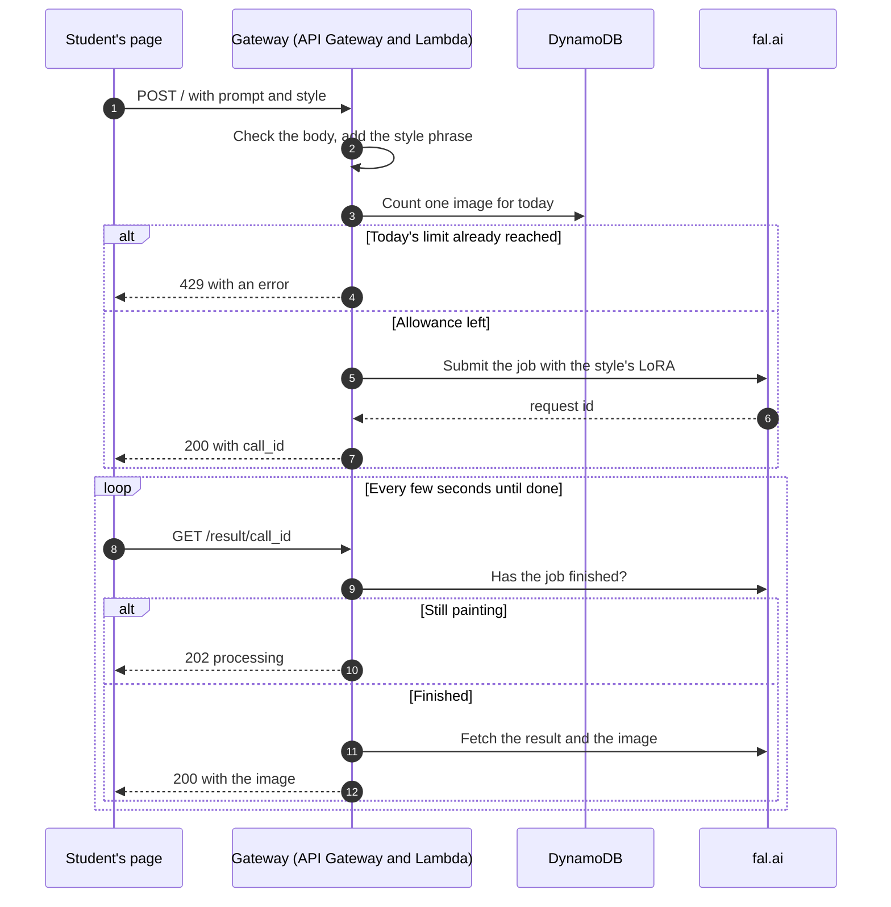
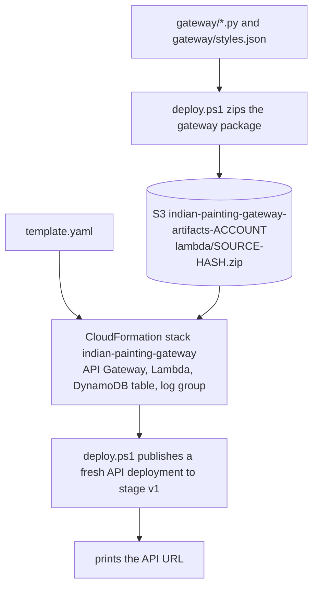
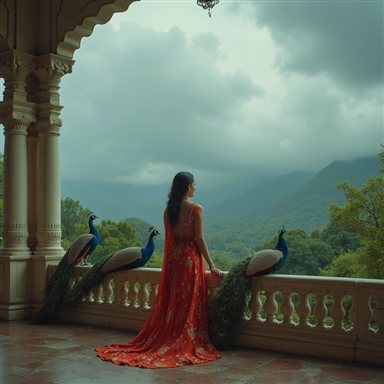
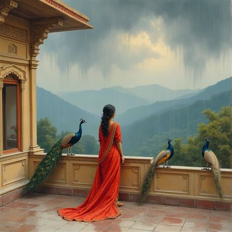

# Indian painting gateway

An HTTP API that paints a prompt in the **Kangra** or **Mughal** miniature style. It runs the two
FLUX.1-dev LoRAs from [Indian-painting-generator](https://github.com/abhilashab4/Indian-painting-generator)
on [fal.ai](https://fal.ai), behind AWS API Gateway and Lambda in ap-south-1 (Mumbai).

It answers exactly like that repo's Modal app and, like it, needs no key, so a page written for
the Modal app only changes its base URL.

```
https://n5pz0b1to2.execute-api.ap-south-1.amazonaws.com/v1
```

| Kangra (`"style": "kangra"`) | Mughal (`"style": "mughal"`) |
|---|---|
|  |  |
| *A shepherd boy resting under a tree with his flock on a Himalayan hillside* | *A court musician playing a veena before the emperor in a marble pavilion* |
|  |  |
| *A princess on a palace terrace watching monsoon clouds, peacocks on the parapet* | *A royal hunting party on horseback in a forest with deer* |

All four were made by this API on 20 November 2026 from exactly the prompts shown, at the default
settings. None of the prompts names a style; the API added it (see [the style phrase](#why-the-api-adds-the-style-phrase)).

**Contents:** [How it works](#how-it-works) · [Using the API](#using-the-api) ·
[Running it](#running-it) · [Design notes](#design-notes) · [Known gaps](#known-gaps)

## How it works



The Lambda does no image work itself. It validates the request, counts it against the daily
limit, hands the job to fal's queue with the right LoRA, and later fetches the finished image and
returns it. fal runs FLUX.1-dev on its own GPUs and bills per image.

## Using the API

Painting takes longer than one HTTP request should wait, so a page makes two calls: one to start
the painting and one, repeated, to collect it.



### 1. Start a painting

`POST /` with a JSON body. Only `prompt` is required.

| Field | Default | Allowed |
|---|---|---|
| `prompt` | (required) | up to 2,000 characters |
| `style` | `"kangra"` | `"kangra"` or `"mughal"` |
| `steps` | `20` | whole number, 1 to 50 |
| `guidance` | `3.5` | 0 to 35 |
| `width`, `height` | `768` | whole number, 256 to 1536, rounded down to a multiple of 16 |
| `lora_scale` | `1.0` | 0 to 2; how strongly the style is applied |

The reply is `200` with `{"call_id": "…", "status": "queued"}`.

If the prompt doesn't contain the style's name (`kangra` or `mughal`, in any case), the API adds
`, Kangra miniature painting` or `, Mughal miniature painting` to the end. Without it the LoRAs
barely change the image.

### 2. Collect it

`GET /result/{call_id}` every few seconds:

- `202` with `{"status": "processing"}` while it is being painted;
- `200` with the image itself once it is done: PNG, or JPEG when width × height is more than
  1024 × 1024. The `X-Image-Url` header gives a public link to the same image on fal's CDN.

An image usually takes 10 to 15 seconds. The first one after a quiet spell takes about a minute,
while fal loads the LoRA onto a fresh GPU.

### Examples

JavaScript in a web page (the API allows calls from any origin):

```js
const API = "https://n5pz0b1to2.execute-api.ap-south-1.amazonaws.com/v1";

async function paint(prompt, style = "kangra") {
  const start = await fetch(`${API}/`, {
    method: "POST",
    headers: { "Content-Type": "application/json" },
    body: JSON.stringify({ prompt, style }),
  });
  if (!start.ok) throw new Error(await reason(start));
  const { call_id } = await start.json();

  for (;;) {
    await new Promise((resolve) => setTimeout(resolve, 3000));
    const result = await fetch(`${API}/result/${call_id}`);
    if (result.status === 202) continue;
    if (!result.ok) throw new Error(await reason(result));
    return URL.createObjectURL(await result.blob()); // use as an  src
  }
}

async function reason(response) {
  const body = await response.json().catch(() => ({}));
  return body.error || body.message || response.statusText;
}
```

Python with `requests`:

```python
import time
import requests

API = "https://n5pz0b1to2.execute-api.ap-south-1.amazonaws.com/v1"

start = requests.post(f"{API}/", json={"prompt": "An emperor in a garden of fountains", "style": "mughal"})
start.raise_for_status()
call_id = start.json()["call_id"]

while True:
    time.sleep(3)
    result = requests.get(f"{API}/result/{call_id}")
    if result.status_code != 202:
        break
result.raise_for_status()

with open("painting.png", "wb") as file:
    file.write(result.content)
```

curl:

```bash
API=https://n5pz0b1to2.execute-api.ap-south-1.amazonaws.com/v1
curl -s "$API/" -H "Content-Type: application/json" -d '{"prompt":"A peacock on a palace wall","style":"kangra"}'
# {"call_id": "01a1f9f9-...", "status": "queued"}
curl -s -o painting.png -w "%{http_code}\n" "$API/result/01a1f9f9-..."   # 202 until ready, then 200
```

### Errors

Errors from the gateway's own code are JSON with an `error` field; errors raised by API Gateway
itself have a `message` field instead.

| Status | Meaning |
|---|---|
| `400` | The body is not valid JSON, a field is missing or out of range, or the `call_id` is not one this API gave out. `error` says which. |
| `404` | fal has no job with this `call_id`, or its result has expired. Start a new painting. |
| `429` | Today's images have been used (1,000 by default). The count resets at midnight IST. |
| `500` | The painting failed; `error` gives fal's reason. With no `error` field, the gateway was too busy; retry a moment later. |
| `502` | fal refused to start the job, for example when the fal balance has run out; `error` gives the reason. The image is not counted. |

fal's safety checker is on, so an image it flags may come back blank.

## Running it

Everything below runs from this folder in Windows PowerShell with the AWS CLI v2 signed in to the
account. If scripts are blocked, run them as `powershell -ExecutionPolicy Bypass -File deploy.ps1`.

### Deploying a change

```powershell
./deploy.ps1                    # deploy with the default limit of 1,000 images a day
./deploy.ps1 -ImagesPerDay 600  # or with another limit
```



The package is named after a hash of its source, so a deploy with unchanged code leaves the Lambda
alone. A new deployment can take a minute to reach every API Gateway node; until then some
requests may still see the old behaviour.

### Setting it up from a fresh clone

1. **fal key.** In a fal.ai account with credit, create a key that can only call models, and
   store it in Secrets Manager:

   ```powershell
   pip install fal                 # the fal CLI
   fal auth login                  # opens a browser
   fal keys create --preset API --desc indian-painting-gateway   # prints FAL_KEY='...'
   aws secretsmanager create-secret --region ap-south-1 --name indian-painting-gateway/fal-key --secret-string "<the FAL_KEY value>"
   ```

2. **Styles.** Copy `styles.example.json` to `gateway/styles.json` and fill in each LoRA's https
   address. The current addresses can be recovered from the deployed Lambda, whose package
   contains `gateway/styles.json`:

   ```powershell
   Invoke-WebRequest -UseBasicParsing (aws lambda get-function --function-name indian-painting-gateway --region ap-south-1 --query Code.Location --output text) -OutFile lambda.zip
   Expand-Archive lambda.zip lambda-package
   Copy-Item lambda-package\gateway\styles.json gateway\styles.json
   Remove-Item -Recurse lambda.zip, lambda-package
   ```

   To upload a new LoRA file to fal's CDN instead (with `FAL_KEY` set in the environment):

   ```powershell
   pip install fal-client
   python -c "import fal_client; print(fal_client.upload_file('kangra_flux_lora_v1.safetensors'))"
   ```

3. **Deploy:** `./deploy.ps1`. It creates the artifacts bucket on its first run.

### Day to day

| Task | How |
|---|---|
| Change the daily limit | `./deploy.ps1 -ImagesPerDay <n>` |
| Change or add a style | Put its LoRA address and phrase in `gateway/styles.json`, then `./deploy.ps1` |
| See images started per day | `aws dynamodb scan --region ap-south-1 --table-name (aws cloudformation describe-stack-resource --region ap-south-1 --stack-name indian-painting-gateway --logical-resource-id UsageTable --query StackResourceDetail.PhysicalResourceId --output text) --query "Items[].[pk.S,images.N]" --output text` (the last 7 days) |
| Read the logs | `aws logs tail /aws/lambda/indian-painting-gateway --since 1h --region ap-south-1` |
| Check the fal balance | The billing page of the fal.ai dashboard |
| Rotate the fal key | Create a new key and store it with `aws secretsmanager put-secret-value --region ap-south-1 --secret-id indian-painting-gateway/fal-key --secret-string "<new key>"`. Running Lambda containers keep the old key, so make them start afresh with `aws lambda update-function-configuration --region ap-south-1 --function-name indian-painting-gateway --description "Starts FLUX LoRA jobs on fal.ai and returns their images. Key rotated <date>."`, then `fal keys revoke <old id>` |

When `styles.json` or the fal key changes, also update the local `.env` and the GitHub secrets
(`gh secret set STYLES_JSON < gateway/styles.json`, `gh secret set FAL_KEY`).

### Where things are

| What | Where |
|---|---|
| API, Lambda, usage table, log group | CloudFormation stack `indian-painting-gateway`, ap-south-1 |
| Lambda packages | S3 `indian-painting-gateway-artifacts-<account id>` |
| fal key (API-only) | Secrets Manager `indian-painting-gateway/fal-key`, made by hand, not by the stack |
| LoRA files | fal CDN; their addresses are in `gateway/styles.json`, which is not in git |
| Logs | CloudWatch `/aws/lambda/indian-painting-gateway`, kept 30 days |
| Local copies of the secrets | `.env` in this folder, not in git: fal key, styles, gateway URL |
| Copies for GitHub Actions | Repository secrets `FAL_KEY` and `STYLES_JSON`. GitHub secrets cannot be read back, only used by a workflow, so they are not a way to recover the values. |

### Repository layout

| Path | What it holds |
|---|---|
| `gateway/handler.py` | Lambda entry point: the two routes and their replies |
| `gateway/generation.py` | The request contract, the style phrase, and the arguments sent to fal |
| `gateway/fal_queue.py` | The only code that talks to fal: submit, check, collect |
| `gateway/daily_limit.py` | The daily image counter in DynamoDB |
| `gateway/settings.py` | Reads the Lambda environment and `styles.json` |
| `gateway/styles.json` | Each style's LoRA address and phrase (not in git) |
| `styles.example.json` | The shape of `styles.json` |
| `template.yaml` | The CloudFormation stack |
| `deploy.ps1`, `stack.ps1` | Packaging and deployment |
| `docs/images/` | The pictures in this README |

### What it costs

- **fal.ai**: $0.035 per megapixel, so about $0.02 per image at 768 × 768 and $0.08 at
  1536 × 1536. At the default limit the most a day can cost is 1,000 images: about $20 at the
  default size, $83 if every image were the largest size.
- **AWS**: Lambda, API Gateway, DynamoDB and S3 come to cents a month at this scale. The Secrets
  Manager secret is $0.40 a month.

### Taking it down

```powershell
$account = aws sts get-caller-identity --query Account --output text
aws cloudformation delete-stack --stack-name indian-painting-gateway --region ap-south-1
aws s3 rb "s3://indian-painting-gateway-artifacts-$account" --force --region ap-south-1
aws secretsmanager delete-secret --secret-id indian-painting-gateway/fal-key --region ap-south-1
fal keys list   # then: fal keys revoke <id>
```

## Design notes

### Why fal and not a GPU on AWS

On 20 November 2026 the AWS account had no GPU quota for SageMaker or EC2 in any region checked,
and an always-on GPU endpoint big enough for FLUX.1-dev would cost $1,100 to $1,800 a month. fal
already hosts FLUX.1-dev with LoRA support, bills per image, and needs no quota.

### Why the API adds the style phrase

The LoRAs were tested on fal with the same prompt, seed (7), steps (20) and size (768 × 768).
Without a style phrase, both LoRAs leave the picture photographic:

| FLUX.1-dev alone | With the Kangra LoRA | With the Mughal LoRA |
|---|---|---|
|  |  |  |

*"A princess on a palace terrace watching monsoon clouds, peacocks on the parapet"*

With the phrase added, FLUX alone gives a semi-realistic painting, and each LoRA turns it into a
flat miniature in its own style:

| Prompt ends with | FLUX.1-dev alone | With its LoRA |
|---|---|---|
| ", Kangra miniature painting" |  |  |
| ", Mughal miniature painting" |  |  |

So the phrase is what switches each LoRA on, and the API adds it when a prompt leaves it out.

### Why there is no key

The API serves one trusted student, and the Modal app it replaces was open too (the owner's
decision, 20 November 2026). Anyone who finds the URL can use it, so the daily image limit in
DynamoDB is what caps spending. API Gateway quotas would count requests, every poll included,
not images, which is why the limit lives in the Lambda. There is no request-rate limit, so a page
can poll as often as it likes.

### Smaller choices

- **Image bytes, not a redirect.** `GET /result` returns the image itself, as the Modal app did,
  so existing pages keep working. Images above one megapixel are JPEG so the base64 reply stays
  under Lambda's 6 MB limit.
- **fal's faster inference** (`acceleration: "regular"`) is on. At the same seed it gave
  practically the same picture in under half the time (4 s of inference instead of 9.5 s).
- **Sides round down to a multiple of 16**, because FLUX works in 16-pixel blocks; the Modal
  app's pipeline did the same.
- **The Lambda keeps its settings, fal key and AWS clients** for the life of a container, so the
  secret is read once per container rather than once per request.
- **Calls from any origin are allowed**, including on API Gateway's own error replies, so a page
  always sees the real status and message.

## Known gaps

- **No unit tests.** The live API was checked end to end on 20 November 2026: the cross-origin
  preflight, a bad style, a missing prompt, invalid JSON, out-of-range steps, a malformed and an
  unknown `call_id`, and real images in both styles.
- **Lambda concurrency.** The account could run 10 Lambda calls at once on 20 November 2026; a
  raise to 1,000 was requested that day. Until it is granted, many requests at the same moment can
  get `500` or `502` with no `error` field, and a retry a moment later works. Check with
  `aws service-quotas get-service-quota --service-code lambda --quota-code L-B99A9384 --region ap-south-1`.
- **The LoRA addresses are unlisted, not private.** Anyone holding one can download the weights.
  They appear only in `gateway/styles.json`, the Lambda package, `.env` and the GitHub secrets,
  never in replies.
