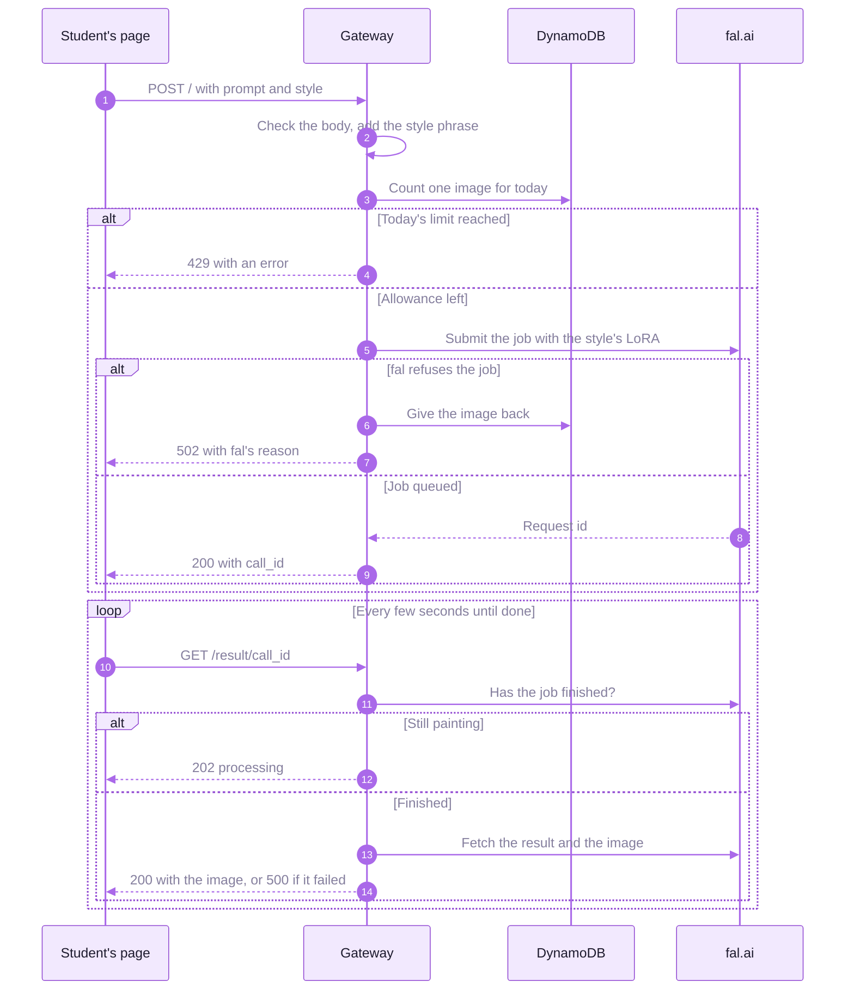

<picture>
  <source media="(prefers-color-scheme: dark)" srcset="readme-kit/assets/divider-dark.svg">
  
</picture>

# &nbsp; Using the API

Everything a page needs to paint a prompt in the Kangra or Mughal style. The API answers exactly like the
Modal app in [Indian-painting-generator](https://github.com/abhilashab4/Indian-painting-generator) and, like
it, needs no key, so a page written for the Modal app only changes its base URL.

```text
https://n5pz0b1to2.execute-api.ap-south-1.amazonaws.com/v1
```

| Section | What it covers |
|---|---|
| [The two calls](#the-two-calls) | why there are two, and what happens between them |
| [1. Start a painting](#1-start-a-painting) | every field, its default and its range |
| [The style phrase](#the-style-phrase) | what the API adds to a prompt, and when |
| [2. Collect it](#2-collect-it) | the replies, the image formats and how long it takes |
| [Examples](#examples) | JavaScript, Python and curl |
| [Errors](#errors) | every status and what to do about it |
| [Calling from a web page](#calling-from-a-web-page) | cross-origin calls and polling |

## The two calls

Painting takes longer than one HTTP request should wait, so a page makes two calls: one to start the
painting and one, repeated, to collect it. Below, the gateway is API Gateway and the Lambda behind it.



A body that fails the check gets `400` before anything is counted, and polling never counts against the
limit: only a painting that starts does.

## 1. Start a painting

`POST /` with a JSON body. Only `prompt` is required; other fields are ignored.

| Field | Default | Allowed |
|---|---|---|
| `prompt` | (required) | up to 2,000 characters; spaces at either end are trimmed |
| `style` | `"kangra"` | `"kangra"` or `"mughal"` |
| `steps` | `20` | whole number, 1 to 50 |
| `guidance` | `3.5` | 0 to 35 |
| `width`, `height` | `768` | whole number, 256 to 1536, rounded down to a multiple of 16 |
| `lora_scale` | `1.0` | 0 to 2; how strongly the style is applied |

The reply is `200` with `{"call_id": "…", "status": "queued"}`.

## The style phrase

If the prompt doesn't contain the chosen style's name (`kangra` or `mughal`, in any case), the API adds
`, Kangra miniature painting` or `, Mughal miniature painting` to the end, after dropping any spaces, full
stops, commas or semicolons the prompt ends with. Without it the LoRAs barely change the image; the
[design notes](DESIGN.md#why-the-api-adds-the-style-phrase) show the comparison. A prompt that already names
its style is sent as written. Only the chosen style's name counts, so a prompt that mentions Mughal still gets
the Kangra phrase when it asks for `"kangra"`.

## 2. Collect it

`GET /result/{call_id}` every few seconds:

- `202` with `{"status": "processing"}` while it is waiting or being painted;
- `200` with the image itself once it is done: PNG, or JPEG when width × height is more than
  1024 × 1024. The `X-Image-Url` header gives a public link to the same image on fal's CDN.

An image usually takes 10 to 15 seconds. The first one after a quiet spell takes about a minute, while fal
loads the LoRA onto a fresh GPU.

## Examples

### JavaScript in a web page

The API allows calls from any origin.

```js
const API = "https://n5pz0b1to2.execute-api.ap-south-1.amazonaws.com/v1";

async function paint(prompt, style = "kangra") {
  const start = await fetch(`${API}/`, {
    method: "POST",
    headers: { "Content-Type": "application/json" },
    body: JSON.stringify({ prompt, style }),
  });
  if (!start.ok) throw new Error(await reason(start));
  const { call_id } = await start.json();

  for (;;) {
    await new Promise((resolve) => setTimeout(resolve, 3000));
    const result = await fetch(`${API}/result/${call_id}`);
    if (result.status === 202) continue;
    if (!result.ok) throw new Error(await reason(result));
    return URL.createObjectURL(await result.blob()); // use as an  src
  }
}

async function reason(response) {
  const body = await response.json().catch(() => ({}));
  return body.error || body.message || response.statusText;
}
```

### Python with `requests`

```python
import time
import requests

API = "https://n5pz0b1to2.execute-api.ap-south-1.amazonaws.com/v1"

start = requests.post(f"{API}/", json={"prompt": "An emperor in a garden of fountains", "style": "mughal"})
start.raise_for_status()
call_id = start.json()["call_id"]

while True:
    time.sleep(3)
    result = requests.get(f"{API}/result/{call_id}")
    if result.status_code != 202:
        break
result.raise_for_status()

with open("painting.png", "wb") as file:
    file.write(result.content)
```

### curl

```bash
API=https://n5pz0b1to2.execute-api.ap-south-1.amazonaws.com/v1
curl -s "$API/" -H "Content-Type: application/json" -d '{"prompt":"A peacock on a palace wall","style":"kangra"}'
# {"call_id": "01a1f9f9-...", "status": "queued"}
curl -s -o painting.png -w "%{http_code}\n" "$API/result/01a1f9f9-..."   # 202 until ready, then 200
```

## Errors

Errors from the gateway's own code are JSON with an `error` field.

| Status | Meaning |
|---|---|
| `400` | The body is not valid JSON, a field is missing or out of range, or the `call_id` is not one this API gave out. `error` says which. |
| `404` | fal has no job with this `call_id`, or its result has expired. Start a new painting. |
| `429` | Today's images have been used (1,000 by default). The count resets at midnight IST. |
| `500` | The painting failed, or fal or the finished image could not be reached; `error` gives the reason, in fal's words where fal gave one, beside `"status": "failed"`. |
| `502` | fal refused to start the job, for example when the fal balance has run out, or could not be reached; `error` gives the reason. The image is not counted. |

A reply with only a `message` field comes from API Gateway itself, not from the gateway's code: most often the
code crashed or ran out of time. `aws logs tail` shows why ([day to day](OPERATIONS.md#day-to-day)), and a
retry usually works.

fal's safety checker is on, so an image it flags may come back blank.

## Calling from a web page

- **Any origin.** Every reply carries `Access-Control-Allow-Origin: *`, including the errors API Gateway
  raises itself, so a page always sees the real status and message. The preflight allows `Content-Type` with
  `GET`, `POST` and `OPTIONS`, and browsers may keep it for two hours.
- **The image link.** `X-Image-Url` is exposed to scripts, so a page can read it as well as the image.
- **Polling.** There is no request-rate limit, so a page can poll as often as it likes; every few seconds is
  plenty.

<picture>
  <source media="(prefers-color-scheme: dark)" srcset="readme-kit/assets/footer-dark.svg">
  
</picture>
