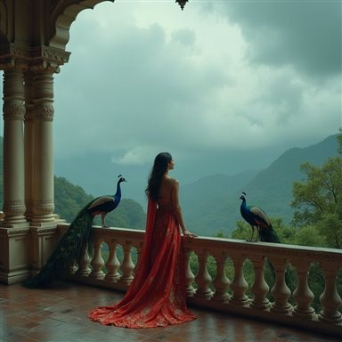
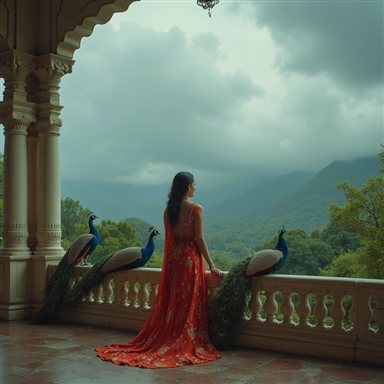
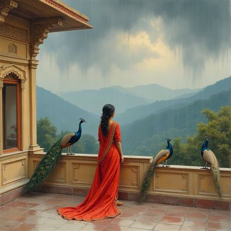
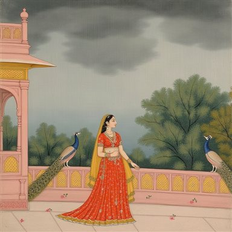
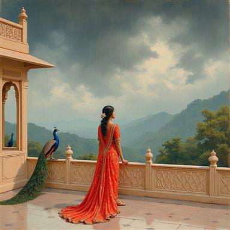
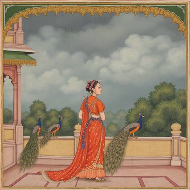

<picture>
  <source media="(prefers-color-scheme: dark)" srcset="readme-kit/assets/divider-dark.svg">
  
</picture>

# &nbsp; Design notes

Why the gateway is built the way it is, and what it still lacks. How to call it is in [API.md](API.md); how to
run it is in [OPERATIONS.md](OPERATIONS.md).

| Section | What it covers |
|---|---|
| [Why fal and not a GPU on AWS](#why-fal-and-not-a-gpu-on-aws) | quota and cost |
| [Why the API adds the style phrase](#why-the-api-adds-the-style-phrase) | the fixed-seed comparisons |
| [Why there is no key](#why-there-is-no-key) | the owner's decision, and what caps spending |
| [Smaller choices](#smaller-choices) | image bytes, faster inference, sizes, caching, counting, CORS |
| [Known gaps](#known-gaps) | tests, and the LoRA addresses |

## Why fal and not a GPU on AWS

On 20 November 2026 the AWS account had no GPU quota for SageMaker or EC2 in any region checked, and an
always-on GPU endpoint big enough for FLUX.1-dev would cost $1,100 to $1,800 a month. fal already hosts
FLUX.1-dev with LoRA support, bills per image, and needs no quota.

## Why the API adds the style phrase

The LoRAs were tested on fal with the same prompt, seed (7), steps (20) and size (768 × 768). Without a style
phrase, both LoRAs leave the picture photographic:

| FLUX.1-dev alone | With the Kangra LoRA | With the Mughal LoRA |
|---|---|---|
|  |  |  |

*"A princess on a palace terrace watching monsoon clouds, peacocks on the parapet"*

With the phrase added, FLUX alone gives a semi-realistic painting, and each LoRA turns it into a flat
miniature in its own style:

| Prompt ends with | FLUX.1-dev alone | With its LoRA |
|---|---|---|
| ", Kangra miniature painting" |  |  |
| ", Mughal miniature painting" |  |  |

So the phrase is what switches each LoRA on, and the API adds it when a prompt leaves it out
([the rule](API.md#the-style-phrase)).

## Why there is no key

The API serves one trusted student, and the Modal app it replaces was open too (the owner's decision,
20 November 2026). Anyone who finds the URL can use it, so the daily image limit in DynamoDB is what caps
spending. API Gateway quotas would count requests, every poll included, not images, which is why the limit
lives in the Lambda. There is no request-rate limit, so a page can poll as often as it likes.

## Smaller choices

- **Image bytes, not a redirect.** `GET /result` returns the image itself, as the Modal app did, so existing
  pages keep working. Images above one megapixel are JPEG so the base64 reply stays under Lambda's 6 MB
  limit.
- **fal's faster inference** (`acceleration: "regular"`) is on. At the same seed it gave practically the same
  picture in under half the time (4 s of inference instead of 9.5 s).
- **Sides round down to a multiple of 16**, because FLUX works in 16-pixel blocks; the Modal app's pipeline
  did the same.
- **The Lambda keeps its settings, fal key and AWS clients** for the life of a container, so the secret is
  read once per container rather than once per request.
- **Count first, give back on refusal.** The image is counted with a conditional update before the job goes
  to fal, so pages calling at the same moment cannot pass the limit together, and the count is given back
  when fal refuses the job.
- **Calls from any origin are allowed**, including on API Gateway's own error replies, so a page always sees
  the real status and message.

## Known gaps

- **No unit tests.** The live API was checked end to end on 20 November 2026: the cross-origin preflight, a
  bad style, a missing prompt, invalid JSON, out-of-range steps, a malformed and an unknown `call_id`, and
  real images in both styles.
- **The LoRA addresses are unlisted, not private.** Anyone holding one can download the weights. They appear
  only in `gateway/styles.json`, the Lambda package, `.env` and the GitHub secrets, and the gateway's code
  never puts them in a reply; a `500` or `502` passes on fal's error text as fal wrote it.

<picture>
  <source media="(prefers-color-scheme: dark)" srcset="readme-kit/assets/footer-dark.svg">
  
</picture>
