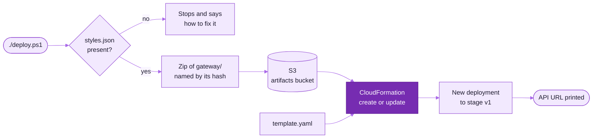

<picture>
  <source media="(prefers-color-scheme: dark)" srcset="readme-kit/assets/divider-dark.svg">
  
</picture>

# &nbsp; Running it

Everything below runs from the repository root in Windows PowerShell with the AWS CLI v2 signed in to the
account. If scripts are blocked, run them as `powershell -ExecutionPolicy Bypass -File deploy.ps1`. Setting
it up from a fresh clone is in [SETUP.md](SETUP.md).

| Section | What it covers |
|---|---|
| [Deploying a change](#deploying-a-change) | what `./deploy.ps1` does, step by step |
| [Day to day](#day-to-day) | the limit, styles, usage, logs, the fal balance and key rotation |
| [Where things are](#where-things-are) | the stack, packages, secrets and logs |
| [Limits](#limits) | images a day, calls at once, timeouts and reply size |
| [What it costs](#what-it-costs) | fal per image, AWS per month |
| [Taking it down](#taking-it-down) | removing everything it made |

## Deploying a change

```powershell
./deploy.ps1                    # deploy with the default limit of 1,000 images a day
./deploy.ps1 -ImagesPerDay 600  # or with another limit
```



1. `deploy.ps1` stops unless `gateway/styles.json` exists.
2. It creates the bucket `indian-painting-gateway-artifacts-<account id>` if it is missing.
3. It zips the `.py` and `.json` files of `gateway/` and uploads the zip as `lambda/<source hash>.zip`.
   The package is named after a hash of its source, so a deploy with unchanged code leaves the Lambda alone.
4. It deploys `template.yaml` as the stack `indian-painting-gateway`: the API, the Lambda and its role, the
   usage table and the log group.
5. CloudFormation only deploys the API stage when the stack is first created, so it then publishes a fresh
   deployment to stage `v1`, and prints the API URL.

A new deployment can take a minute to reach every API Gateway node; until then some requests may still see
the old behaviour.

## Day to day

| Task | How |
|---|---|
| Change the daily limit | `./deploy.ps1 -ImagesPerDay <n>` |
| Change or add a style | Put its LoRA address and phrase in `gateway/styles.json`, then `./deploy.ps1` |
| See images started per day | `aws dynamodb scan --region ap-south-1 --table-name (aws cloudformation describe-stack-resource --region ap-south-1 --stack-name indian-painting-gateway --logical-resource-id UsageTable --query StackResourceDetail.PhysicalResourceId --output text) --query "Items[].[pk.S,images.N]" --output text` (the last 7 days) |
| Read the logs | `aws logs tail /aws/lambda/indian-painting-gateway --since 1h --region ap-south-1` |
| Check the fal balance | The billing page of the fal.ai dashboard |
| Rotate the fal key | Create a new key and store it with `aws secretsmanager put-secret-value --region ap-south-1 --secret-id indian-painting-gateway/fal-key --secret-string "<new key>"`. Running Lambda containers keep the old key, so make them start afresh with `aws lambda update-function-configuration --region ap-south-1 --function-name indian-painting-gateway --description "Starts FLUX LoRA jobs on fal.ai and returns their images. Key rotated <date>."`, then `fal keys revoke <old id>` |

When `styles.json` or the fal key changes, also update the local `.env` and the GitHub secrets
(`gh secret set STYLES_JSON < gateway/styles.json`, `gh secret set FAL_KEY`).

## Where things are

| What | Where |
|---|---|
| API, Lambda, usage table, log group | CloudFormation stack `indian-painting-gateway`, ap-south-1 |
| Lambda packages | S3 `indian-painting-gateway-artifacts-<account id>` |
| fal key (API-only) | Secrets Manager `indian-painting-gateway/fal-key`, made by hand, not by the stack |
| LoRA files | fal CDN; their addresses are in `gateway/styles.json`, which is not in git |
| Logs | CloudWatch `/aws/lambda/indian-painting-gateway`, kept 30 days |
| Local copies of the secrets | `.env` in the repository root, not in git: fal key, styles, gateway URL |
| Copies for GitHub Actions | Repository secrets `FAL_KEY` and `STYLES_JSON`. GitHub secrets cannot be read back, only used by a workflow, so they are not a way to recover the values. |

## Limits

| Limit | Value | Set by |
|---|---|---|
| Images a day | 1,000 by default; the count resets at midnight IST | `-ImagesPerDay`, the stack parameter `ImagesPerDay` |
| Lambda calls at once | 1,000 in the account, raised by AWS on 21 November 2026 | the Lambda concurrency quota for ap-south-1 |
| Requests a second | no limit of its own | |
| One call | 28 s for the Lambda, because API Gateway gives up after 29 s; 10 s for each call to fal, 15 s for the image download | `template.yaml`, `gateway/fal_queue.py` |
| One reply | Lambda's 6 MB, which is why images above one megapixel come back as JPEG | `gateway/generation.py` |

An image is counted when its painting starts, with a conditional update, so two pages at the same moment
cannot pass the limit together; if fal refuses the job, the image is given back. Polls are never counted.
Each day's counter expires a week after its last count, and DynamoDB then deletes it.

To check the concurrency quota:

```powershell
aws service-quotas get-service-quota --service-code lambda --quota-code L-B99A9384 --region ap-south-1
```

## What it costs

- **fal.ai**: $0.035 per megapixel, so about $0.02 per image at 768 × 768 and $0.08 at 1536 × 1536. At the
  default limit the most a day can cost is 1,000 images: about $20 at the default size, $83 if every image
  were the largest size.
- **AWS**: Lambda, API Gateway, DynamoDB and S3 come to cents a month at this scale. The Secrets Manager
  secret is $0.40 a month.

## Taking it down

```powershell
$account = aws sts get-caller-identity --query Account --output text
aws cloudformation delete-stack --stack-name indian-painting-gateway --region ap-south-1
aws s3 rb "s3://indian-painting-gateway-artifacts-$account" --force --region ap-south-1
aws secretsmanager delete-secret --secret-id indian-painting-gateway/fal-key --region ap-south-1
fal keys list   # then: fal keys revoke <id>
```

<picture>
  <source media="(prefers-color-scheme: dark)" srcset="readme-kit/assets/footer-dark.svg">
  
</picture>
